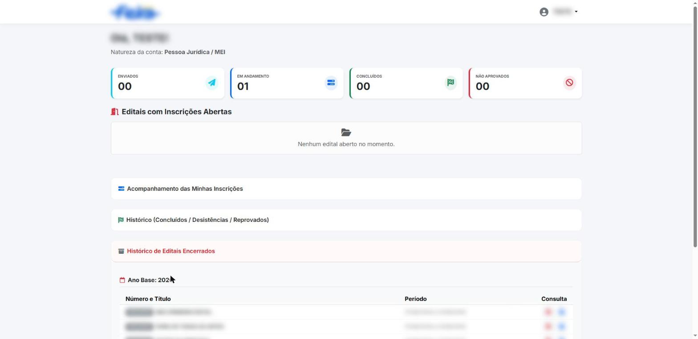
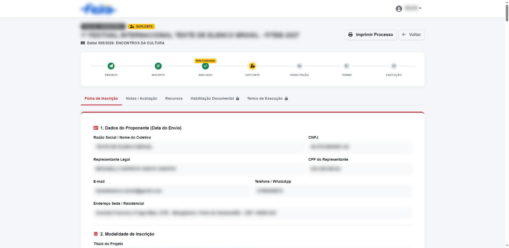
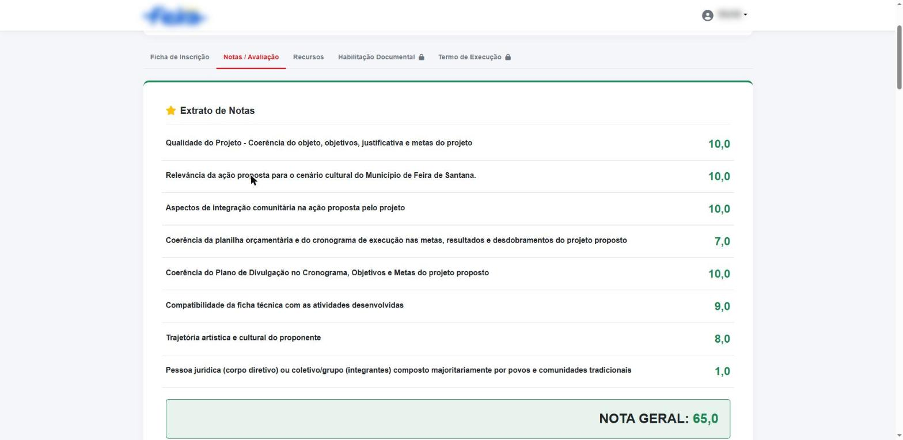
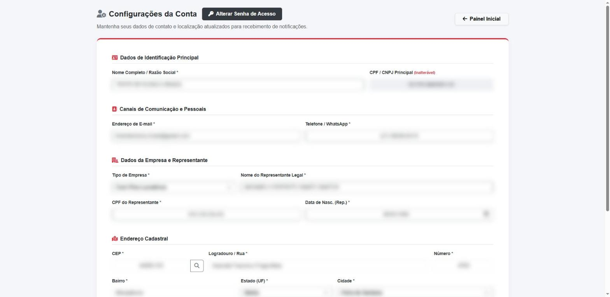

# Levantamento do portal de referência

Leitura feita em 07/11/2026 no Chrome, só olhando. Nenhum formulário enviado, nenhum cadastro alterado, nenhum upload, nenhuma senha digitada.

Referência: portal de editais culturais da Política Nacional Aldir Blanc de um município baiano. Aqui está só a **função** de cada tela. A identidade visual, o brasão, a marca e os textos oficiais não serão copiados.

**Dados pessoais.** A conta usada na leitura tem dados reais de pessoas e de uma empresa. Nada disso foi copiado para este documento. As capturas estão borradas nos campos, nomes, números de documento, logotipos e textos longos.

## Mapa de telas

| Tela | Quem vê | Onde aparece |
|---|---|---|
| Login em 2 etapas | Público | Página inicial sem sessão |
| Esqueci minha senha | Público | Link na tela de login |
| Criar conta | Público | Mesma tela de login: o documento novo leva ao cadastro. Hoje mostra "Cadastro suspenso" |
| Painel do Proponente | Proponente logado | Página inicial com sessão |
| Aviso em janela | Proponente logado | Abre por cima do painel. Botão "Ciente, fechar" |
| Visualizar inscrição | Proponente logado | Botão "Visualizar" em cada inscrição |
| Imprimir processo | Proponente logado | Botão na inscrição |
| Minha conta | Proponente logado | Menu do usuário |
| Alterar senha | Proponente logado | Janela dentro de Minha conta |
| Sair | Proponente logado | Menu do usuário |
| Área administrativa, avaliação, comissão | Equipe do órgão | Não visível ao proponente. Deduzida pelo que aparece nas inscrições |

## 1. Acesso

**Login em 2 etapas.** Etapa 1: campo "CPF ou CNPJ" e botão "Avançar". Se o documento existe, etapa 2 pede a senha. Se não existe, segue para criar conta.

- "Esqueci minha senha" na etapa da senha.
- Aviso global de cadastro suspenso, controlado pela equipe.
- Não há página pública de editais, resultados ou contato. Tudo fica atrás do login.

## 2. Painel do Proponente

- Saudação com o nome e a **natureza da conta** (Pessoa Física, Pessoa Jurídica ou MEI, Coletivo).
- 4 contadores: **Enviados**, **Em andamento**, **Concluídos**, **Não aprovados**.
- **Editais com inscrições abertas**: cartões com botão para se inscrever. Mensagem "Nenhum edital aberto no momento" quando vazio.
- **Acompanhamento das minhas inscrições** (sanfona): por inscrição, protocolo, cota escolhida, título do projeto, edital, selo de situação (ex.: Suplente), nota geral e botão Visualizar.
- **Linha do tempo de 7 etapas** em cada inscrição: Enviado, Inscrito, Avaliado, Suplente ou Selecionado, Habilitação, Termo, Execução. Etapas passadas em verde, atual destacada, futuras em cinza.
- **Histórico** (concluídos, desistências, reprovados).
- **Histórico de editais encerrados** agrupado por ano base: número e título, período de inscrição, botões **Baixar edital** (PDF) e **Baixar anexos** (ZIP).
- **Aviso em janela** aberto ao entrar, com texto definido pela equipe (no dia: prazo de envio da habilitação).

Editais vistos no histórico de 2026 (6): primeiro edital para iniciantes, feira de todas as artes, raízes culturais, encontros da cultura, premiação de pontos e pontões de cultura, TCC de pontos de cultura. Todos com o mesmo período de inscrição.

## 3. Visualizar inscrição

Cabeçalho: protocolo, selo de situação, título do projeto, edital, botões **Imprimir processo** e **Voltar**. Linha do tempo com marcador extra quando há recurso ("Nota contestada").

Abas:

1. **Ficha de inscrição**: cópia somente leitura do que foi enviado, congelada na data do envio.
2. **Notas / Avaliação**: extrato por critério, nota geral, parecer técnico, contestação e parecer da comissão.
3. **Recursos**: recursos das outras fases (habilitação, resultado).
4. **Habilitação documental**: travada (cadeado) até a proposta ser selecionada. Depois, um campo de anexo por documento exigido, com prazo.
5. **Termo de execução**: travado até a habilitação. Depois, o termo para assinar e acompanhar.

### 3.1 Conteúdo da ficha (formulário de inscrição)

O formulário muda por edital. Blocos encontrados:

1. **Dados do proponente** copiados da conta no envio: nome ou razão social, documento, representante legal e CPF, e-mail, telefone, endereço.
2. **Modalidade**: título do projeto, segmento ou categoria, cota escolhida (ampla concorrência, pessoas negras, indígenas, PcD).
3. **Perguntas do edital**: comunidade tradicional, raça, cor ou etnia, declaração étnico-racial (anexo), **tabela de membros para heteroidentificação** (nome, CPF, cota, foto e documento anexados), pessoa com deficiência, declaração e laudo PcD (anexos).
4. **Dados da pessoa jurídica**: razão social, nome fantasia, data de fundação, representante, anos de atuação, se acessou recurso público nos últimos 5 anos.
5. **Pontuação bônus**: caixas de marcar (ex.: maioria de mulheres, execução fora da sede) com anexos de prova.
6. **Declaração** com aceite.
7. **Plano de trabalho**: mini currículo ou portfólio (anexo), descrição do projeto, objetivos, **metas** (tabela etapa, início, fim, ação), perfil do público.
8. **Acessibilidade**: caixas por tipo (arquitetônica, comunicacional, atitudinal) e texto de como será feita.
9. **Divulgação**: tabela etapa, início, fim, ação.
10. **Equipe**: tabela nome, função, documento, mini currículo.
11. **Datas** de início e fim da execução e **cronograma** (tabela).
12. **Planilha orçamentária**: descrição, categoria, unidade de medida, quantidade, valor unitário, total, com **soma automática** e teto do edital.
13. **Outras fontes de recurso** e **venda de ingressos** (com valores).
14. **Anexos diversos** opcionais.
15. Marca de que o texto informativo de cada bloco foi lido.

Tipos de campo que o construtor de formulário precisa: texto curto, texto longo, data, número, moeda, escolha única, múltipla escolha, sim ou não, anexo (vários arquivos), tabela repetível com colunas próprias, aceite e bloco informativo.

### 3.2 Notas e avaliação

- **Extrato de notas**: lista de critérios do edital, cada um com nota (ex.: 0 a 10) e critérios de bônus.
- **Nota geral** somada.
- **Parecer técnico** do avaliador, com versão "após reavaliação do recurso".
- **Contestação de notas (recurso)**: situação do recurso, texto da justificativa do proponente.
- **Parecer da comissão sobre o recurso**: acolhe e devolve ao avaliador, ou indefere.

Fluxo deduzido: avaliador dá notas e parecer, resultado preliminar sai, proponente abre recurso no prazo, comissão decide, avaliador reavalia, resultado final.

Limite visto no sistema de referência: não aceita nota zero sem desclassificar, até em critério de bônus. O nosso deve aceitar zero em bônus sem desclassificar.

## 4. Minha conta

- Dados de identificação: nome ou razão social, CPF ou CNPJ **inalterável**.
- Contato: e-mail, telefone ou WhatsApp.
- Empresa e representante: tipo (MEI, com fins lucrativos, sem fins lucrativos), nome, CPF e data de nascimento do representante.
- Endereço: CEP com botão de busca, logradouro, número, bairro, UF e cidade (lista de municípios do IBGE).
- Botão "Salvar alterações cadastrais".
- **Alterar senha**: senha atual, nova, confirmação.

## 5. Área da equipe (deduzida)

Não vista diretamente, porque a conta é de proponente. O que precisa existir para o painel funcionar:

- **Editais**: criar, abrir e fechar inscrições, anexar PDF do edital e ZIP de anexos, cotas, categorias, faixas de valor, teto do orçamento, critérios de nota com peso e máximo, documentos de habilitação.
- **Construtor do formulário** por edital (tipos de campo da seção 3.1).
- **Inscrições**: lista com filtros, ficha, situação, protocolo gerado no envio.
- **Avaliação**: distribuir inscrições para avaliadores, notas por critério, parecer, conflito de interesse.
- **Resultado** preliminar e final, suplentes, por cota.
- **Recursos**: receber, decidir pela comissão, devolver ao avaliador.
- **Habilitação**: conferir documentos, aprovar ou pedir correção.
- **Termo e execução**: gerar termo, acompanhar execução e prestação de contas.
- **Avisos** em janela e o interruptor de cadastro suspenso.
- **Usuários e papéis**: proponente, avaliador, comissão, administrador.

## 6. Técnico observado

- Servidor em PHP com páginas por módulo e ação. Arquivos enviados ficam em pasta pública por edital.
- Bibliotecas por CDN: Bootstrap, Font Awesome, jQuery.
- Lista de UF e municípios pela API pública do IBGE (servicodados.ibge.gov.br).
- Ponto de atenção: os PDFs de editais ficam em caminho público previsível. No nosso, anexos de inscrição nunca ficam públicos.

## 7. O que não foi possível ver

- Formulário de inscrição em branco: nenhum edital aberto no dia. Os campos vieram da ficha enviada.
- Tela de criar conta: cadastro suspenso.
- Habilitação e termo preenchidos: etapas travadas para esta conta.
- Área administrativa: exige outra conta.

---
Levantamento por Emanuel Macêdo Luz, desenvolvedor do projeto.
